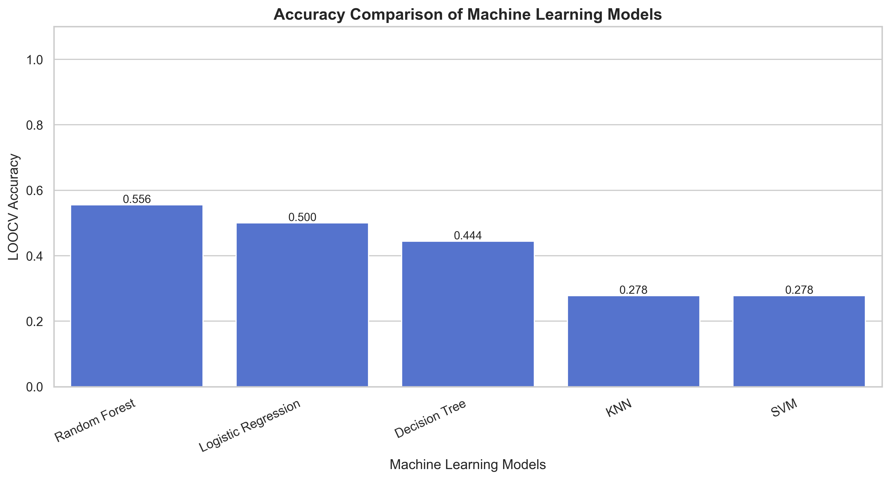
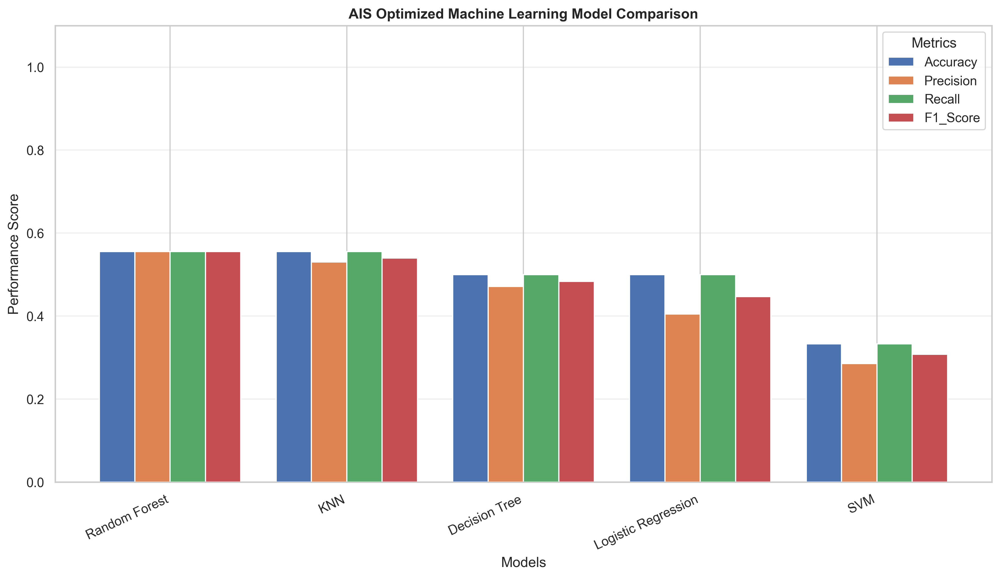
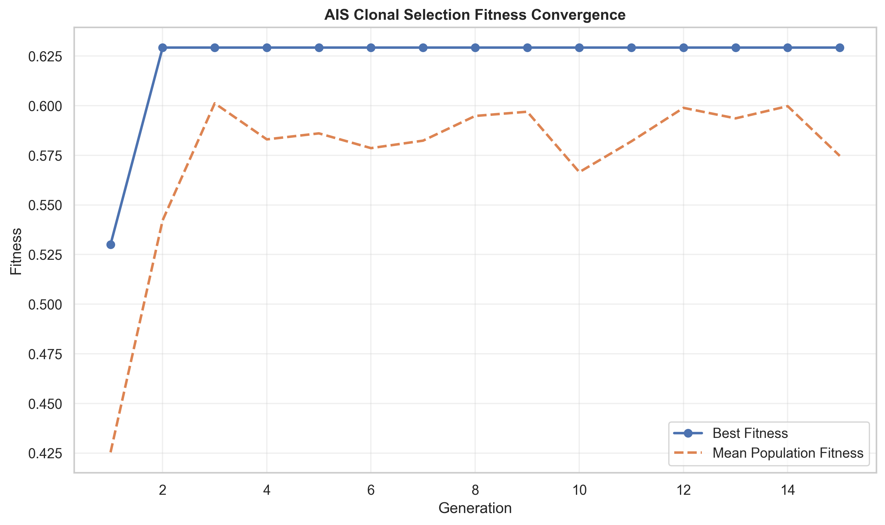
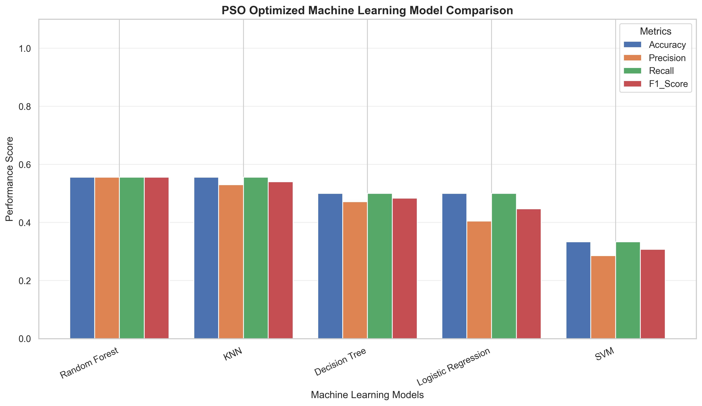
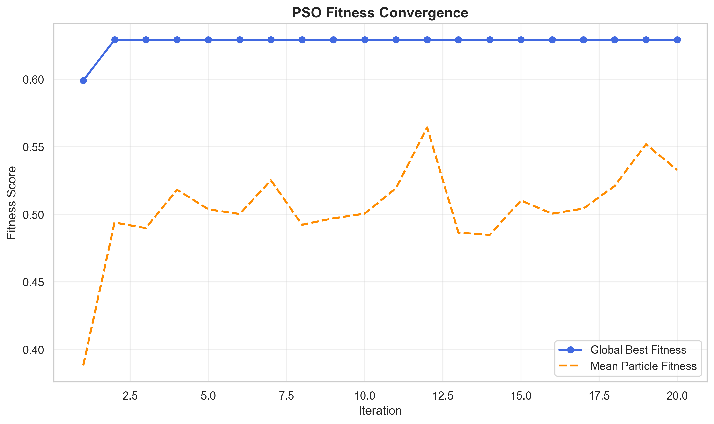
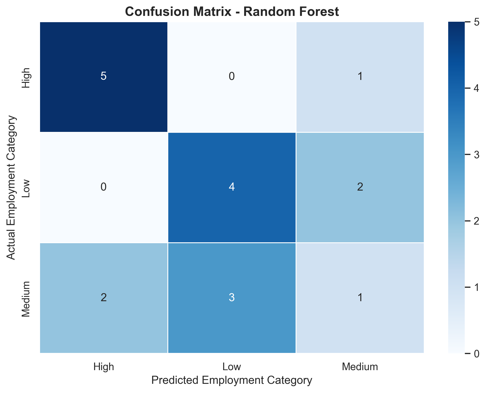
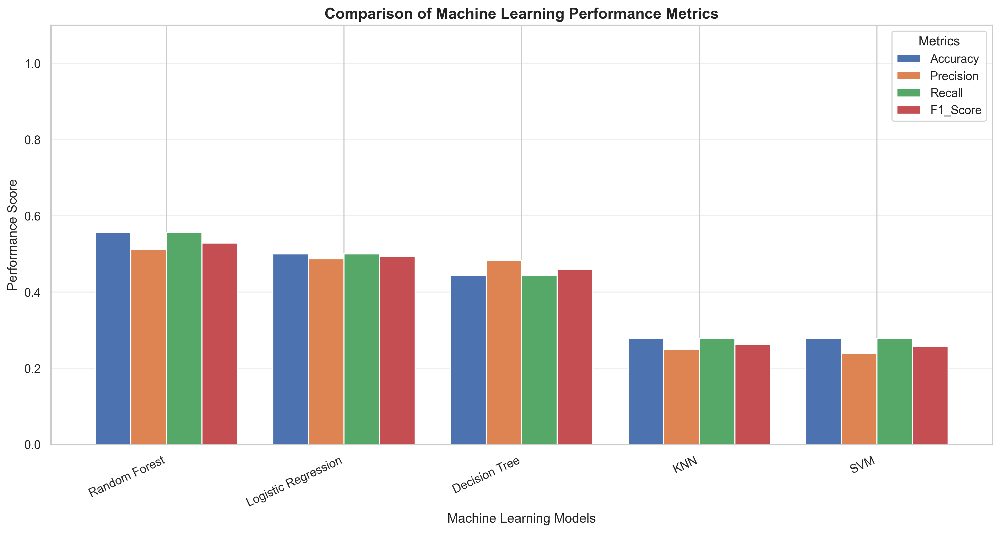
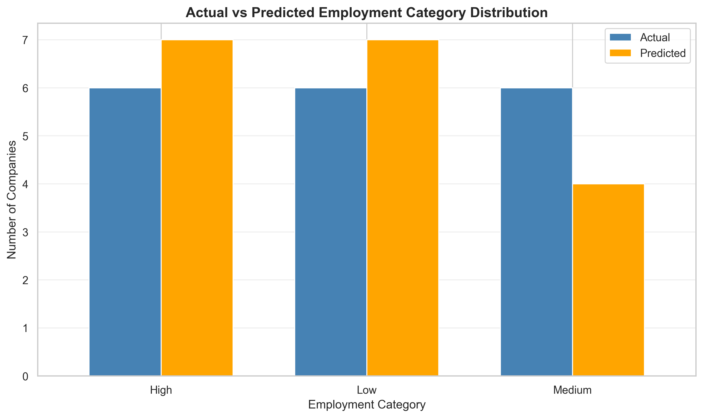
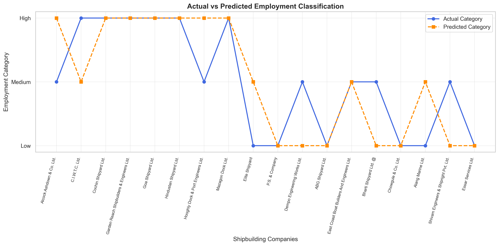

# AI-Based Shipbuilding and Ship Repairing Employment Pattern Analysis Using Machine Learning, AIS and PSO

## 📌 Project Overview

This project focuses on analyzing employment patterns in the Indian shipbuilding and ship repairing industry using Machine Learning (ML), Artificial Immune System (AIS), and Particle Swarm Optimization (PSO).

The study uses historical employment data from **31st March 1996** to investigate workforce distribution, employment categories, and organizational staffing patterns across shipbuilding and ship repairing companies.

The project implements multiple machine learning classification algorithms to classify companies into Low, Medium, and High employment categories based on their workforce characteristics.

Two optimization techniques, **Artificial Immune System (AIS)** and **Particle Swarm Optimization (PSO)**, are incorporated to identify informative features and examine their effects on classification performance.

The system also generates evaluation metrics, prediction files, comparative visualizations, trained models, and configuration files.

---

## 🎯 Project Objectives

The major objectives of this project are:

1. Analyze employment patterns in shipbuilding and ship repairing companies.
2. Study workforce distribution across public and private sectors.
3. Examine the employment composition of officers, supervisors, and operational workers.
4. Classify companies into Low, Medium, and High employment categories.
5. Implement multiple machine learning classification algorithms.
6. Evaluate models using accuracy, precision, recall, and F1-score.
7. Apply Artificial Immune System (AIS) for feature selection.
8. Apply Particle Swarm Optimization (PSO) for feature optimization.
9. Compare conventional ML, AIS-based ML, and PSO-based ML approaches.
10. Generate graphical reports and prediction results.
11. Save trained models and preprocessing objects for reuse.
12. Provide a reproducible experimental framework for historical workforce analysis.

---

## 📊 Dataset Description

### Dataset Name

**Employment in Ship Building and Ship Repairing Companies as on 31st March 1996**

### Dataset File

`10.3_Employment_in_Ship_Building_Ship_Repairing_Companies_As_on_31st_March_1996.csv`

### Dataset Information

| Attribute | Description |
|-----------|-------------|
| Domain | Shipbuilding and Ship Repairing |
| Industry | Maritime Industry |
| Country | India |
| Reference Date | 31st March 1996 |
| Data Type | Historical Employment Data |
| Original Records | 18 |
| Original Columns | 8 |
| Target Variable | Employment_Category |
| Problem Type | Multiclass Classification |
| Classes | Low, Medium, High |
| Optimization Methods | AIS and PSO |

### Dataset Attributes

| Column | Description |
|--------|-------------|
| S. No. | Serial number |
| Category of Sectors | Public or private sector |
| Name of the Company | Name of the shipbuilding company |
| Officers | Number of officers employed |
| Supervisors | Number of supervisors |
| Workforce - Directly Involved in Operation | Direct operational workforce |
| Workforce - Indirectly Involved in Operation | Indirect operational workforce |
| Total | Total employment |

### Target Variable

The target variable is:

`Employment_Category`

Companies are categorized into three groups:

- **Low Employment:** Companies with relatively smaller workforces.
- **Medium Employment:** Companies with intermediate workforce sizes.
- **High Employment:** Companies with relatively larger workforces.

Employment categories are generated using dataset-based tertile thresholds.

These categories are relative to the historical dataset and are not official industry employment classifications.

---

## 🖼️ Main Project Visualization

The following graph compares the classification accuracy of the conventional machine learning models.



**Figure 1:** Machine Learning Model Accuracy Comparison

The graph presents the accuracy obtained by different machine learning classifiers using Leave-One-Out Cross-Validation.

It helps identify differences in classification performance across the evaluated algorithms.

The accuracy values are generated during execution and are not fixed in advance.

---

## 🧠 Machine Learning Algorithms

The project implements five machine learning algorithms.

### 1. Logistic Regression

Logistic Regression is a supervised learning algorithm used for classification.

It estimates the relationship between workforce features and employment categories.

**Applications:**
- Employment category classification
- Workforce pattern analysis
- Baseline model evaluation

### 2. Decision Tree Classifier

Decision Tree creates a hierarchical structure of decision rules.

It identifies patterns in workforce composition to classify employment categories.

**Applications:**
- Interpretable workforce classification
- Employment category analysis
- Decision-rule extraction

### 3. Random Forest Classifier

Random Forest combines multiple decision trees to improve prediction stability.

It is useful for studying nonlinear relationships between workforce characteristics and employment categories.

**Applications:**
- Workforce classification
- Nonlinear pattern analysis
- Ensemble learning

### 4. Support Vector Machine (SVM)

Support Vector Machine identifies decision boundaries between employment categories.

The project uses an RBF kernel to model nonlinear relationships.

**Applications:**
- Multiclass classification
- Workforce pattern recognition
- Employment category prediction

### 5. K-Nearest Neighbors (KNN)

KNN classifies companies based on similarity to other companies in the feature space.

**Applications:**
- Similarity-based classification
- Workforce comparison
- Employment pattern recognition

---

## ⚙️ Data Preprocessing

Data preprocessing is performed before model training.

### Step 1: Dataset Loading

The CSV dataset is loaded using Pandas.

### Step 2: Column Standardization

Column names are cleaned and standardized.

Examples:

- `Category of Sectors` → `Sector`
- `Name of the Company` → `Company`
- `Total` → `Total_Employment`

### Step 3: Missing Value Handling

Missing numeric values are handled using median imputation.

Missing categorical values are handled using the most frequent category.

Missing workforce counts are not automatically interpreted as zero.

### Step 4: Feature Engineering

Workforce composition features are calculated using the following formula:

Workforce Share = Workforce Component / Total Employment

The engineered features include:

- Officers_Share
- Supervisors_Share
- Direct_Workers_Share
- Indirect_Workers_Share

### Step 5: Categorical Encoding

Categorical features are converted into numerical representations using One-Hot Encoding.

### Step 6: Feature Scaling

StandardScaler is applied to numerical features.

### Step 7: Target Encoding

Employment categories are converted into numerical labels using LabelEncoder.

### Step 8: Cross-Validation

Leave-One-Out Cross-Validation (LOOCV) is used for model evaluation.

Each iteration trains on all records except one and predicts the remaining record.

**Important:** Workforce shares are calculated using total employment. Although the total is excluded as a direct model feature, this is still a retrospective composition-based analysis, not a prospective prediction system for companies whose total employment is unknown.

---

## 🧬 Artificial Immune System (AIS)

Artificial Immune System is a computational optimization technique inspired by the biological immune system.

The project implements a Clonal Selection Algorithm to identify informative workforce features.

### AIS Working Principle

1. Generate an initial population of antibodies.
2. Represent each antibody as a binary feature-selection vector.
3. Evaluate antibody fitness using classification performance.
4. Select antibodies with higher fitness.
5. Clone the selected antibodies.
6. Apply mutation to cloned antibodies.
7. Replace weaker antibodies.
8. Repeat the optimization process.
9. Select the feature subset with the best fitness.

### AIS Fitness Function

The fitness function combines classification performance with a feature-selection penalty.

Fitness = Weighted F1-score - Feature Penalty

The feature penalty discourages unnecessarily large feature subsets.

### AIS Configuration

| Parameter | Value |
|-----------|-------|
| Algorithm | Clonal Selection |
| Population Size | 12 |
| Generations | 15 |
| Clone Factor | 4 |
| Replacement Rate | 0.25 |
| Fitness Metric | Weighted F1-score |
| Fitness Evaluator | Logistic Regression |

### AIS Outputs

- `ais_accuracy_graph.png`
- `ais_heatmap.png`
- `ais_comparison_graph.png`
- `ais_result.csv`
- `ais_result_graph.png`
- `ais_prediction.csv`
- `ais_prediction_graph.png`
- `ais_fitness_graph.png`
- `ais_feature_selection_graph.png`
- `ais_feature_selection.csv`
- `ais_model_comparison.csv`
- `ais_selected_features.json`
- `ais_shipbuilding_model.pkl`
- `ais_shipbuilding_model.h5`
- `ais_model_config.yaml`
- `ais_model_metadata.json`

### AIS Visualization



**Figure 2:** Comparison of AIS-optimized machine learning classifiers.

### AIS Fitness Convergence



**Figure 3:** Best and mean fitness values across AIS generations.

---

## 🐝 Particle Swarm Optimization (PSO)

Particle Swarm Optimization is a population-based optimization algorithm inspired by the collective behavior of birds and fish.

The project implements Binary PSO to optimize feature selection.

### PSO Working Principle

1. Initialize a population of particles.
2. Represent each particle as a binary feature-selection vector.
3. Calculate the fitness of each particle.
4. Identify each particle's personal best solution.
5. Identify the global best solution.
6. Update particle velocities.
7. Convert velocities into binary feature-selection decisions.
8. Repeat until the maximum number of iterations is reached.
9. Select the global best feature subset.

### PSO Velocity Update

The velocity update equation is:

v(t+1) = w × v(t) + c1 × r1 × (pbest - x(t)) + c2 × r2 × (gbest - x(t))

Where:

- w = Inertia weight
- c1 = Cognitive coefficient
- c2 = Social coefficient
- r1, r2 = Random values
- pbest = Personal best position
- gbest = Global best position
- x(t) = Current particle position

### Binary Position Update

A sigmoid function converts particle velocity into a probability.

Sigmoid(v) = 1 / (1 + exp(-v))

The binary position is determined by comparing this probability with a random number.

### PSO Configuration

| Parameter | Value |
|-----------|-------|
| Algorithm | Binary PSO |
| Number of Particles | 15 |
| Maximum Iterations | 20 |
| Inertia Weight | 0.7 |
| Cognitive Coefficient | 1.5 |
| Social Coefficient | 1.5 |
| Fitness Metric | Weighted F1-score |
| Fitness Evaluator | Logistic Regression |

### PSO Outputs

- `pso_accuracy_graph.png`
- `pso_heatmap.png`
- `pso_comparison_graph.png`
- `pso_result.csv`
- `pso_result_graph.png`
- `pso_prediction.csv`
- `pso_prediction_graph.png`
- `pso_fitness_graph.png`
- `pso_feature_selection_graph.png`
- `pso_feature_selection.csv`
- `pso_model_comparison.csv`
- `pso_selected_features.json`
- `pso_shipbuilding_model.pkl`
- `pso_shipbuilding_model.h5`
- `pso_model_config.yaml`
- `pso_model_metadata.json`

### PSO Visualization



**Figure 4:** Comparison of PSO-optimized machine learning classifiers.

### PSO Fitness Convergence



**Figure 5:** Global best and mean particle fitness across PSO iterations.

---

## 🔬 Project Methodology

The overall methodology consists of the following stages:

```text
                 START
                   |
                   v
             Load Dataset
                   |
                   v
            Data Cleaning
                   |
                   v
          Feature Engineering
                   |
                   v
        Employment Classification
                   |
                   v
           Data Preprocessing
                   |
                   v
       ---------------------------
       |            |            |
       v            v            v
   Standard ML     AIS          PSO
       |            |            |
       |       Clonal Selection  |
       |            |            |
       |            |       Binary Particle
       |            |           Swarm
       |            |            |
       v            v            v
     Model        Feature       Feature
    Training      Selection     Selection
       |            |            |
       |            v            v
       |        ML Training   ML Training
       |            |            |
       v            v            v
       ---------------------------
                   |
                   v
           Model Evaluation
                   |
                   v
          Accuracy / F1-score
                   |
                   v
           Confusion Matrix
                   |
                   v
          Result and Prediction
                   |
                   v
         Generate Visualizations
                   |
                   v
         Save Models and Reports
                   |
                   v
                  END
```

---

## 📈 Model Evaluation Metrics

The following metrics are used to evaluate classification performance.

### Accuracy

Accuracy measures the proportion of correctly classified samples.

Accuracy = (TP + TN) / (TP + TN + FP + FN)

### Precision

Precision measures the proportion of predicted positive samples that are actually positive.

Precision = TP / (TP + FP)

### Recall

Recall measures the proportion of actual positive samples correctly identified.

Recall = TP / (TP + FN)

### F1-score

F1-score is the harmonic mean of precision and recall.

F1 = 2 × (Precision × Recall) / (Precision + Recall)

For multiclass classification, weighted averages are calculated using class support.

### Confusion Matrix

The confusion matrix summarizes the relationship between actual and predicted employment categories.

It helps identify classification errors across Low, Medium, and High employment groups.

---

## 📊 Standard Machine Learning Visualizations

### 1. Accuracy Graph


Displays the accuracy comparison of conventional machine learning models.

### 2. Confusion Matrix



Displays actual versus predicted employment categories.

### 3. Model Comparison Graph



Compares accuracy, precision, recall, and F1-score.

### 4. Classification Results Graph



Compares the actual and predicted number of companies in each employment category.

### 5. Prediction Graph



Displays actual and predicted employment categories for individual companies.

---

## 📉 AIS and PSO Comparative Analysis

The project supports three experimental approaches.

| Approach | Optimization | Models |
|----------|--------------|--------|
| Standard ML | None | LR, DT, RF, SVM, KNN |
| AIS-Based ML | Clonal Selection | LR, DT, RF, SVM, KNN |
| PSO-Based ML | Binary Particle Swarm Optimization | LR, DT, RF, SVM, KNN |

### Comparison Criteria

The approaches can be compared using:

- Classification accuracy
- Precision
- Recall
- Weighted F1-score
- Number of selected features
- Optimization fitness
- Model complexity
- Computational cost

### Performance Interpretation

AIS and PSO aim to identify informative subsets of workforce features.

Feature selection may improve performance, reduce unnecessary features, or simplify models.

However, optimization does not guarantee improved accuracy.

Actual performance depends on the dataset, classification algorithm, optimization settings, and evaluation procedure.

### Evaluation Limitation

The supplied AIS and PSO implementations select features using the full dataset before LOOCV model evaluation.

Therefore, their reported performance metrics may be optimistic because feature selection has already used information from the evaluation records.

For rigorous comparison, feature selection and model selection should be performed inside nested cross-validation.

---

## 🗂️ Project Folder Structure

```text
AI-Based Shipbuilding and Ship Repairing Employment Pattern Analysis/
│
├── 10.3_Employment_in_Ship_Building_Ship_Repairing_Companies_As_on_31st_March_1996.csv
│
├── README.md
├── shipbuilding_analysis.ipynb
│
├── # STANDARD MACHINE LEARNING
│
├── shipbuilding_model.h5
├── shipbuilding_model.pkl
├── preprocessor.pkl
├── label_encoder.pkl
├── model_config.yaml
├── model_metadata.json
├── processed_dataset.csv
├── model_comparison.csv
├── result.csv
├── prediction.csv
├── accuracy_graph.png
├── heatmap.png
├── comparison_graph.png
├── result_graph.png
├── prediction_graph.png
│
├── # ARTIFICIAL IMMUNE SYSTEM
│
├── ais_shipbuilding_model.h5
├── ais_shipbuilding_model.pkl
├── ais_preprocessor.pkl
├── ais_label_encoder.pkl
├── ais_model_config.yaml
├── ais_model_metadata.json
├── ais_selected_features.json
├── ais_model_comparison.csv
├── ais_feature_selection.csv
├── ais_result.csv
├── ais_prediction.csv
├── ais_accuracy_graph.png
├── ais_heatmap.png
├── ais_comparison_graph.png
├── ais_result_graph.png
├── ais_prediction_graph.png
├── ais_fitness_graph.png
├── ais_feature_selection_graph.png
├── ais_neural_network_accuracy.png
│
├── # PARTICLE SWARM OPTIMIZATION
│
├── pso_shipbuilding_model.h5
├── pso_shipbuilding_model.pkl
├── pso_preprocessor.pkl
├── pso_label_encoder.pkl
├── pso_model_config.yaml
├── pso_model_metadata.json
├── pso_selected_features.json
├── pso_model_comparison.csv
├── pso_feature_selection.csv
├── pso_result.csv
├── pso_prediction.csv
├── pso_accuracy_graph.png
├── pso_heatmap.png
├── pso_comparison_graph.png
├── pso_result_graph.png
├── pso_prediction_graph.png
├── pso_fitness_graph.png
├── pso_feature_selection_graph.png
└── pso_neural_network_accuracy.png
```

---

## 💻 Technologies Used

### Programming Language

- Python

### Development Environment

- Jupyter Notebook
- Anaconda (optional)
- Visual Studio Code (optional)

### Libraries

| Library | Purpose |
|---------|---------|
| NumPy | Numerical computations |
| Pandas | Data preprocessing and analysis |
| Matplotlib | Graph generation |
| Seaborn | Statistical visualizations |
| Scikit-learn | Machine learning and evaluation |
| TensorFlow | Neural network training |
| Keras | Deep learning model development |
| Pickle | Model serialization |
| PyYAML | Configuration management |
| JSON | Metadata storage |
| Pathlib | File and directory management |

---

## ⚙️ Installation

### Step 1: Install Python

Install Python and Jupyter Notebook.

Python 3.10 or 3.11 is recommended for compatibility with the project's dependencies.

### Step 2: Clone the Repository

```bash
git clone https://github.com/YOUR_USERNAME/YOUR_REPOSITORY.git
```

### Step 3: Open the Project Directory

```bash
cd YOUR_REPOSITORY
```

### Step 4: Install Dependencies

```bash
pip install numpy pandas matplotlib seaborn scikit-learn tensorflow h5py pyyaml joblib notebook
```

### Step 5: Start Jupyter Notebook

```bash
jupyter notebook
```

### Step 6: Configure Dataset Path

Set the dataset directory in the notebook.

```python
from pathlib import Path

BASE_DIR = Path(
    r"C:\Users\sagni\Downloads"
    r"\AI-Based Shipbuilding and Ship Repairing Employment Pattern Analysis"
)

DATASET_PATH = BASE_DIR / (
    "10.3_Employment_in_Ship_Building_"
    "Ship_Repairing_Companies_As_on_31st_March_1996.csv"
)
```

### Step 7: Run the Notebooks

Execute the implementations in this order:

1. Standard Machine Learning
2. Artificial Immune System
3. Particle Swarm Optimization

Each implementation saves its corresponding models, graphs, and CSV files.

---

## 📁 Generated Output Files

### Model Files

| Extension | Description |
|-----------|-------------|
| `.pkl` | Trained scikit-learn model and preprocessing objects |
| `.h5` | Experimental neural network model |
| `.yaml` | Project and model configuration |
| `.json` | Model metadata and selected features |

### CSV Files

| File | Description |
|------|-------------|
| result.csv | Classification results |
| prediction.csv | Company-level predictions |
| model_comparison.csv | ML performance comparison |
| ais_result.csv | AIS classification results |
| ais_prediction.csv | AIS prediction results |
| ais_model_comparison.csv | AIS model comparison |
| pso_result.csv | PSO classification results |
| pso_prediction.csv | PSO prediction results |
| pso_model_comparison.csv | PSO model comparison |

### Visualization Files

The project generates high-resolution PNG visualizations for conventional machine learning, AIS, and PSO.

All visualizations are saved at 300 DPI.

---

## 💾 Loading Saved Models

### Load Standard ML Model

```python
import pickle

with open("shipbuilding_model.pkl", "rb") as f:
    model = pickle.load(f)

print("Standard ML model loaded successfully.")
```

### Load AIS Model

```python
import pickle

with open("ais_shipbuilding_model.pkl", "rb") as f:
    ais_model = pickle.load(f)

print("AIS model loaded successfully.")
```

### Load PSO Model

```python
import pickle

with open("pso_shipbuilding_model.pkl", "rb") as f:
    pso_model = pickle.load(f)

print("PSO model loaded successfully.")
```

### Load Neural Network

```python
from tensorflow import keras

model = keras.models.load_model(
    "shipbuilding_model.h5",
    compile=False
)

print("Neural network loaded successfully.")
```

**Note:** Neural network inference requires the matching saved preprocessor and selected feature list. The `.h5` file is not interchangeable with the `.pkl` classifier.

Only load serialized model files from trusted sources.

---

## 🔍 Applications

The project demonstrates how machine learning and optimization techniques can be applied to historical employment data.

Potential applications include:

1. Historical maritime workforce analysis.
2. Public and private sector employment comparisons.
3. Workforce composition studies.
4. Employment category classification.
5. Feature-selection research.
6. Machine learning algorithm benchmarking.
7. AIS and PSO optimization experiments.
8. Educational demonstrations of workforce analytics.
9. Exploratory maritime industry research.

---

## ⚠️ Limitations

### 1. Small Dataset

The dataset contains only 18 original records.

Such a small dataset limits the reliability and generalizability of machine learning models.

### 2. Historical Data

The employment information represents the industry as of March 1996.

The results do not describe current maritime employment conditions.

### 3. Dataset-Derived Labels

Employment categories are generated using the total workforce and dataset-based thresholds.

They are not independently observed ground-truth categories.

### 4. Potential Information Leakage

Workforce shares use total employment in their calculation.

This means the classification is a retrospective composition-based task rather than a true prediction of employment size from independently available information.

### 5. Feature Selection Bias

AIS and PSO perform feature selection before the reported LOOCV evaluation.

This can produce optimistic estimates of model performance.

### 6. Limited Deep Learning Validation

The neural network is trained on a very small dataset.

Its training accuracy is not an unbiased measure of predictive performance.

### 7. No Future Employment Forecasting

The dataset represents a single historical reference date.

It cannot independently support time-series forecasting of future employment.

---

## 🚀 Future Enhancements

Future improvements may include:

- Collecting additional employment records from multiple years.
- Incorporating more shipbuilding and ship repairing companies.
- Adding regional and company-level characteristics.
- Using nested cross-validation for unbiased optimization evaluation.
- Implementing regression for workforce-size estimation.
- Comparing additional optimization algorithms.
- Developing explainable machine learning models.
- Creating interactive dashboards using Streamlit or Plotly.
- Applying SHAP for model interpretability.
- Developing a web-based workforce analytics application.
- Incorporating economic and maritime industry indicators.
- Performing longitudinal workforce trend analysis.

---

## 📌 Expected Outcomes

The project is designed to produce:

- Cleaned historical employment data.
- Employment category assignments.
- Workforce composition analysis.
- Trained machine learning classifiers.
- AIS-optimized feature subsets.
- PSO-optimized feature subsets.
- Classification performance metrics.
- Confusion matrices.
- Model comparison visualizations.
- Company-level classification results.
- Saved machine learning and neural network models.
- Configuration and metadata files.

The actual model performance depends on the dataset and experimental settings.

No specific accuracy improvement is assumed in advance.

---

## 🏁 Conclusion

This project presents an exploratory machine learning framework for analyzing employment patterns in the Indian shipbuilding and ship repairing industry.

The study combines conventional classification algorithms with Artificial Immune System and Particle Swarm Optimization techniques to investigate feature selection and employment classification.

The framework supports comparative analysis of workforce characteristics, classification performance, and optimization behavior.

Although the limited historical dataset restricts the reliability of predictive conclusions, the project demonstrates practical applications of data preprocessing, feature engineering, supervised learning, metaheuristic optimization, and model evaluation.

With larger and more comprehensive datasets, the framework could be extended to support more reliable maritime workforce analytics.

---

## 📚 References

1. Scikit-learn Documentation  
   https://scikit-learn.org/stable/

2. Pandas Documentation  
   https://pandas.pydata.org/docs/

3. NumPy Documentation  
   https://numpy.org/doc/

4. Matplotlib Documentation  
   https://matplotlib.org/stable/

5. Seaborn Documentation  
   https://seaborn.pydata.org/

6. TensorFlow Documentation  
   https://www.tensorflow.org/

7. Keras Documentation  
   https://keras.io/

8. Kennedy, J., & Eberhart, R. (1995). Particle Swarm Optimization. Proceedings of IEEE International Conference on Neural Networks.

9. de Castro, L. N., & Von Zuben, F. J. (2002). Learning and Optimization Using the Clonal Selection Principle. IEEE Transactions on Evolutionary Computation.

---

## ⭐ Project Highlights

- Machine Learning-Based Employment Classification
- Historical Maritime Workforce Analysis
- Artificial Immune System Optimization
- Binary Particle Swarm Optimization
- Five Classification Algorithms
- Leave-One-Out Cross-Validation
- Feature Selection and Optimization
- Confusion Matrix Analysis
- Model Performance Comparison
- Automated Graph Generation
- CSV Result and Prediction Export
- Model Serialization Using PKL and H5
- YAML and JSON Configuration Management
- Reproducible Jupyter Notebook Workflow

---

**Project Title:** AI-Based Shipbuilding and Ship Repairing Employment Pattern Analysis Using Machine Learning, Artificial Immune System and Particle Swarm Optimization

**Domain:** Artificial Intelligence | Machine Learning | Maritime Industry | Workforce Analytics

**Dataset Reference Year:** 1996

**Programming Language:** Python

**Optimization Algorithms:** AIS and PSO
